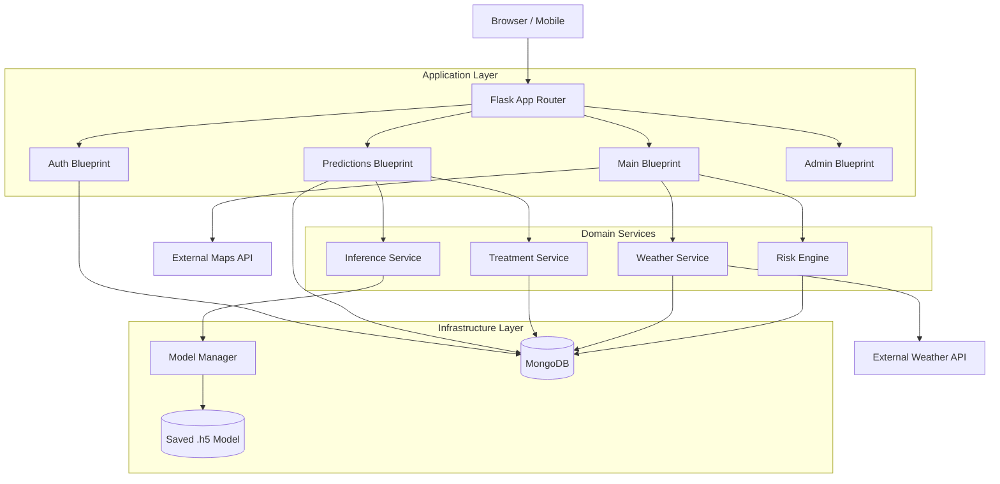

# 04 - System Architecture

## 1. High-Level Architecture

The platform uses a monolithic modular architecture built with Flask, ensuring simplicity and maintainability while separating concerns.

## 2. Components

- **Frontend**: HTML/CSS templates using Bootstrap 5. Dynamic elements use vanilla JavaScript. 
- **Application Layer**: Flask Blueprints acting as controllers. Validates input, coordinates domain services, and returns responses.
- **Domain Services**: Encapsulate business logic. 
  - *Inference Service*: Handles image preprocessing and model communication.
  - *Treatment Service*: Retrieves structured treatment data.
  - *Risk Engine*: Evaluates weather patterns against defined disease risk rules.
- **Model Manager**: Wraps the TensorFlow/Keras model. Ensures the model is loaded only once into memory, handles versioning, and provides a mock/fallback when the model file is missing.
- **Data Layer**: MongoDB accessed via PyMongo. Provides fast document storage for unstructured JSON data (predictions, disease metadata).

## 3. Failure Handling Boundaries
- **ML Model Failure**: If the model fails to load or crashes, the system falls back to a graceful error or demo mode, allowing the rest of the application (weather, history, forums) to continue functioning.
- **External API Failure**: If the Weather API fails, the Risk Engine gracefully degrades, marking risks as "UNKNOWN", preventing a system-wide crash.
